<a href="https://luisverabyte.com">
  <picture>
    <source media="(prefers-color-scheme: dark)" srcset="assets/portada-oscuro.svg">
    <source media="(prefers-color-scheme: light)" srcset="assets/portada-claro.svg">
    
  </picture>
</a>

<p align="center">
  <a href="https://luisverabyte.com"><b>Descarga desde la web</b></a> ·
  <a href="#cómo-se-instala">Cómo se instala</a> ·
  <a href="#en-cualquier-ai">Sin Claude</a> ·
  <a href="https://luisverabyte.com/#newsletter">Newsletter</a> ·
  <a href="https://github.com/luisverabyte/automated-video">English version</a>
</p>

<p align="center">
  
  
  
  <a href="LICENSE"></a>
</p>

Editar cada video me tomaba más de 2 horas. Ahora grabo, se lo paso a Claude y en 20 minutos me lo devuelve listo. Estos son los 3 skills con los que pasé de editar mis videos a delegarlos.

El paso 1 es el que nadie te está enseñando: **tu propio design system**. Todos están editando con Claude y todos los videos se ven iguales. Los míos no, y nadie nota que los edita Claude, porque cada pieza sale con mi marca. Con este kit, los tuyos salen con la tuya.

> [!TIP]
> Empieza por el paso 1. Los otros dos leen el archivo que ese paso crea, así tus guiones suenan a ti y tus subtítulos llevan tus colores.

## Los 3 pasos

<table>
  <tr>
    <td width="72" valign="top"></td>
    <td>
      <h3>Crea tu design system &nbsp;<sub>⭐ tu diferencial</sub></h3>
      <p>Una entrevista guiada, una pregunta a la vez: colores, tipografía, voz, estilo de video y de subtítulos. Si no sabes de diseño, te propone opciones. Al final te entrega tu <code>design-system.md</code>, el archivo que usan los otros dos pasos.</p>
      <p><i>Funciona en Claude, ChatGPT, Gemini y cualquier AI.</i></p>
      <p><a href="design-system/"><code>design-system/</code></a> · <a href="design-system/design-system.txt">versión texto plano</a> · <a href="design-system/ejemplo/design-system.md">ejemplo terminado</a></p>
    </td>
  </tr>
  <tr>
    <td valign="top"></td>
    <td>
      <h3>Escribe tu guion</h3>
      <p>Guiones de Reels, TikTok y Shorts con una estructura de storytelling que engancha en los primeros segundos, en tu voz. Trae tabla de tomas (qué se ve y qué se dice), datos curiosos y notas para verificar lo que afirmas.</p>
      <p><i>Funciona en Claude y en cualquier AI que escriba.</i></p>
      <p><a href="guion-video/"><code>guion-video/</code></a> · <a href="guion-video/texto-plano.md">versión texto plano</a></p>
    </td>
  </tr>
  <tr>
    <td valign="top"></td>
    <td>
      <h3>Edita tu video, con subtítulos</h3>
      <p>Corta silencios y tomas repetidas, mete zoom entre cortes, pone subtítulos palabra por palabra con tu estilo y agrega música y marca de agua. Corre en tu computadora con herramientas gratis (Whisper y ffmpeg): sin suscripciones.</p>
      <p><i>Edita solo en Claude Code o Cowork. En otras AI te guía con los comandos.</i></p>
      <p><a href="editar-video/"><code>editar-video/</code></a> · <a href="editar-video/texto-plano.md">versión texto plano</a></p>
    </td>
  </tr>
  <tr>
    <td valign="top"></td>
    <td>
      <h3>¡Bonus de regalo: teleprompter! &nbsp;</h3>
      <p>No hace falta para que el kit funcione, por eso va de regalo. Cuando apruebas un guion, te arma una página con solo lo que vas a decir, en orden, con tus colores y avance automático. Grabas de corrido, sin memorizar.</p>
      <p><a href="teleprompter/"><code>teleprompter/</code></a> · <a href="teleprompter/texto-plano.md">versión texto plano</a></p>
    </td>
  </tr>
</table>

## Cómo se instala

<details open>
<summary><b>Claude (web, escritorio o celular)</b></summary>

1. Descarga el `.zip` del skill desde [luisverabyte.com](https://luisverabyte.com). No lo descomprimas.
2. En Claude, entra a **Customize → Skills**.
3. Toca **+**, luego **Create skill** y **Upload a skill**, y elige el `.zip`.
4. Abre un chat nuevo y pide lo que quieres, por ejemplo: *"Ayúdame a crear mi design system"*.

Necesitas un plan de pago de Claude con la ejecución de código activada. Repite con cada skill.

</details>

<details>
<summary><b>Claude Code</b></summary>

```bash
git clone https://github.com/luisverabyte/video-automatico.git
cp -r video-automatico/{design-system,guion-video,editar-video,teleprompter} ~/.claude/skills/
```

Copia el archivo `FORMATO-DESIGN-SYSTEM.md` dentro de `~/.claude/skills/design-system/`. Para usarlos solo en un proyecto, cópialos a `.claude/skills/` de ese proyecto.

</details>

<details>
<summary><b id="en-cualquier-ai">En cualquier AI (ChatGPT, Gemini y otras)</b></summary>

1. Abre la versión **texto plano** del skill (enlaces arriba) y cópiala completa.
2. Pégala en un chat nuevo y envíala. La AI aprende el skill para esa conversación.
3. Cuando termines el paso 1, guarda tu `design-system.md` para no repetir la entrevista:
   - **ChatGPT:** súbelo como archivo a un Proyecto o a un GPT propio, junto con el texto plano del skill.
   - **Gemini:** créale una Gem y súbelo como conocimiento.
   - **Otras:** pégalo al inicio de cada chat nuevo, antes del texto del skill.

Los pasos 1 y 2 funcionan completos en cualquier AI. El paso 3 necesita correr programas en tu computadora: ahí te guía con los comandos para tu terminal. Para que edite solo, usa Claude Code o Cowork.

</details>

## Qué hay en este repo

```
design-system/       paso 1 · entrevista que crea tu design-system.md
guion-video/         paso 2 · guiones de video corto con tu voz
editar-video/        paso 3 · edición con subtítulos (scripts en Python + ffmpeg)
teleprompter/        bonus · página para leer mientras grabas
FORMATO-DESIGN-SYSTEM.md   el formato del archivo que comparten los cuatro
LICENSE              MIT, autor original: Luis Vera (@luisverabyte)
```

Cada carpeta trae un `SKILL.md` (para Claude) y su versión texto plano (para cualquier AI).

## Quién está detrás

Soy Luis Vera, AI Product Manager. No soy desarrollador: construyo con AI y cuento cómo lo hago. Uso estos skills cada semana para mis videos en [@luisverabyte](https://www.instagram.com/luisverabyte).

Si quieres ver cómo los uso en la vida real, y lo que voy delegando cada semana, [suscríbete a la newsletter](https://luisverabyte.com/#newsletter).

## Licencia y autoría

Libre y gratis bajo licencia [MIT](LICENSE): úsalo, adáptalo y compártelo, también en proyectos comerciales. La única condición es mantener el aviso de autoría. Si lo compartes o publicas una versión tuya, menciona que el kit original es de **Luis Vera ([@luisverabyte](https://luisverabyte.com))** y enlaza este repo.

<p align="center">
  <a href="https://www.instagram.com/luisverabyte">Instagram</a> ·
  <a href="https://www.linkedin.com/in/luisverabyte">LinkedIn</a> ·
  <a href="https://www.youtube.com/@luisverabyte">YouTube</a> ·
  <a href="https://www.tiktok.com/@luisverabyte">TikTok</a>
</p>
